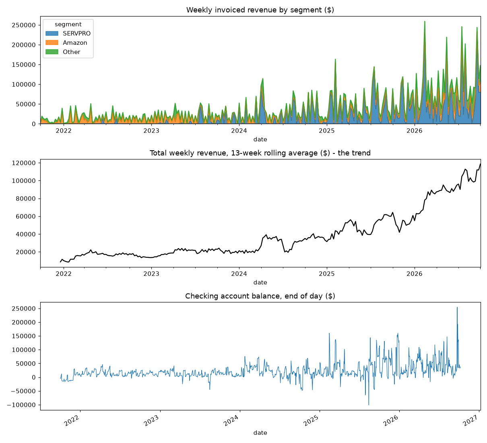
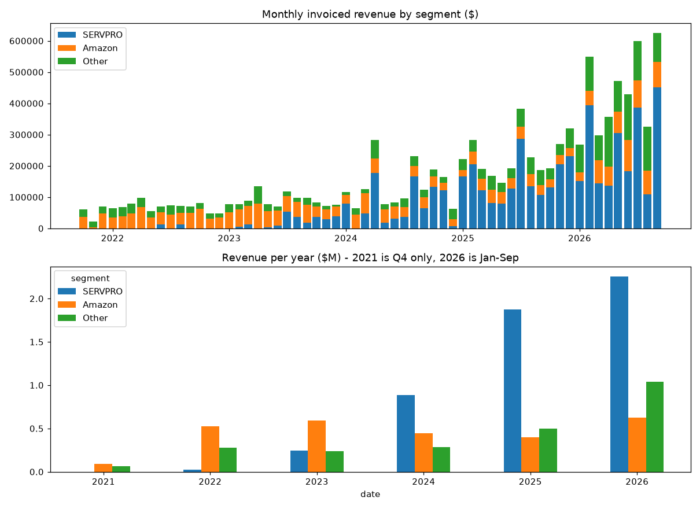
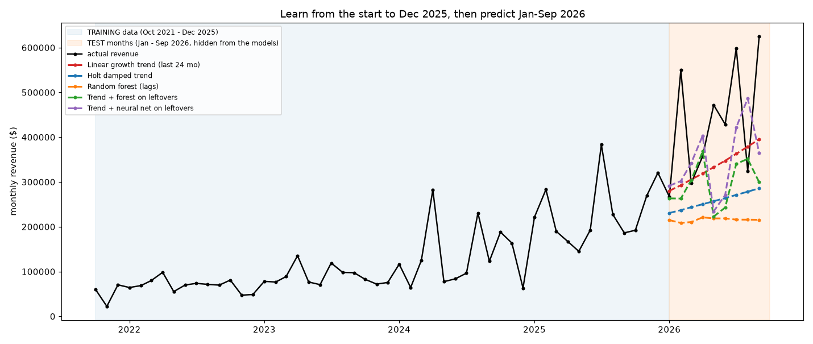
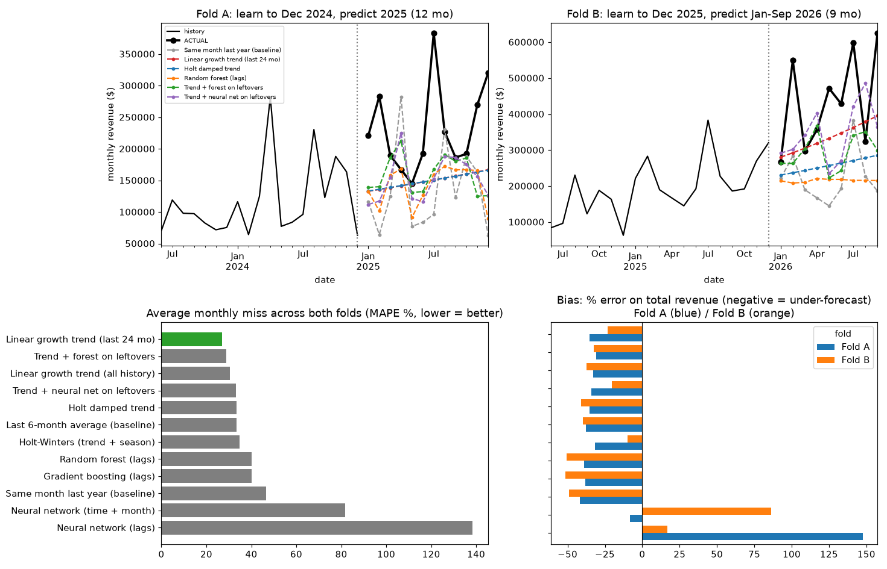
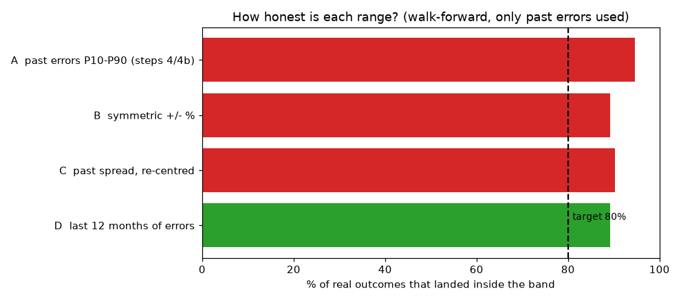
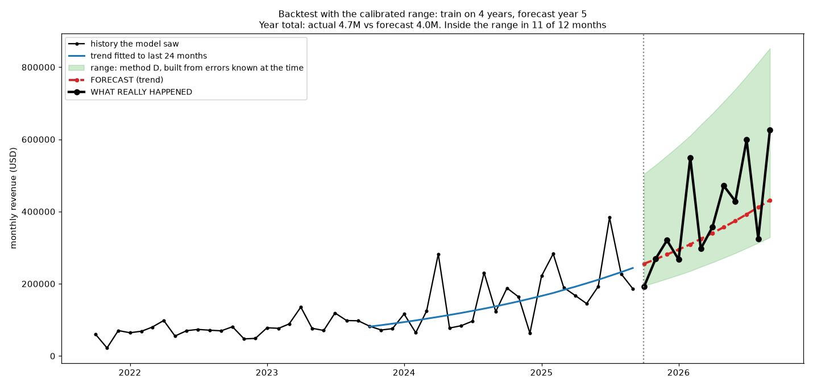
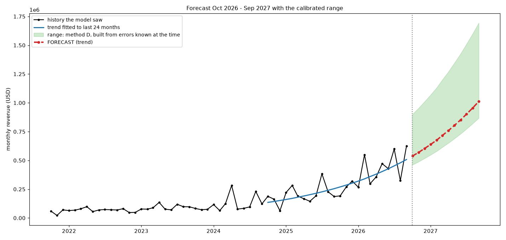

*How we predicted, how we compared models, and what we found. Based on five years of Zoho Books history (Oct 2021 to Sep 2026) from the Gutster Tools cash flow project.*

# 1. The question

The cash flow forecast covers 52 weeks. For the first 13 weeks, machine learning decides when each open invoice and sales order will be paid. After week 13 there are no open invoices to time, so the forecast rests on fixed assumptions.

**The question we set out to answer: can five years of history predict future revenue well enough to replace those fixed assumptions, and how wrong will it be?**

The short answer: it can predict the growth trend and give an honest range. It cannot predict single months closely. Section 8 explains why.

# 2. Our approach in six steps

| Step | What we did | Why |
|---|---|---|
| 1 | Looked at the data before modelling | Find problems early |
| 2 | Cleaned the invoices and built one row per month | Models need a clean table |
| 3 | Compared 12 forecasting models on months they had not seen | Find out what actually works |
| 4 | Trained the best model on everything and forecast 12 months | The deliverable |
| 4b | Re-ran the same forecast in the past (train on 4 years, predict year 5) | See what a miss looks like |
| 5 | Calibrated the range so it contains the real outcome often enough | A forecast without an honest range misleads |

# 3. The data

The source is a read-only export of Zoho Books covering ten datasets: invoices, payments, sales orders, bills, purchase orders, expenses, bank transactions and more. This work uses the **invoices**.

| Cleaning rule | Invoices |
|---|---|
| Raw | 3,529 |
| Removed: void | 19 |
| Removed: draft | 12 |
| Removed: $0 total (all paid, no revenue effect) | 87 |
| **Kept** | **3,411 ($10.37M)** |

The current month (only 6 days of data) was left out, so it could not look like a collapse. The result is **60 clean months with no gaps**. Revenue is also split into three segments: SERVPRO, Amazon and Other.

What the data looks like:

- **Revenue grew about ten times** in five years, from $0.83M in 2022 to $3.92M in the first nine months of 2026, and the growth sped up.
- **Revenue is concentrated.** SERVPRO is about 50% of revenue and the top five customers are 75%.
- **Single months are lumpy.** A month can swing from $270k to $550k with no warning.
- **The bank balance is not a trend.** It is managed with transfers and deposits, so we forecast revenue and cash flows, not the balance itself.

# 4. How we test fairly

A forecast is only worth something if it works on data it has not seen. Three rules kept the comparison honest.

**Rule 1: test on the future, never on random months.** Each model learns from history up to a chosen month (the origin), forecasts the months after it in one go, and is scored against what really happened. A random split would let the model peek at the future and flatter every result.

**Rule 2: two separate tests, not one.** With a single test period a model can look good or bad by luck.

- **Fold A:** learn up to Dec 2024, predict all of 2025 (12 months).
- **Fold B:** learn from Oct 2021 up to Dec 2025, predict Jan to Sep 2026 (9 months).

**Rule 3: always compare against simple baselines.** A model is only useful if it beats "same as last year" and "same as the last six months".

**The score** is MAPE, the average percentage by which a monthly forecast missed. Lower is better. We also look at **bias**: whether a model is consistently too low or too high on total revenue.

# 5. The models we compared

We compared **12 models in five families**, from the simplest to the most complex.

| Family | Models | How it works, in plain words |
|---|---|---|
| Baselines | Same month last year. Last 6-month average. | No learning. The bar every model must clear. |
| Trend lines | Linear growth trend (all history, or last 24 months). | Draws a straight line through log revenue, which means steady percentage growth, and extends it. |
| Smoothing | Holt damped trend. Holt-Winters (trend plus season). | Weights recent months more and follows level and trend. Holt-Winters also learns a yearly pattern. |
| Tree models | Random forest. Gradient boosting. | Learn from the last 1, 2, 3 and 12 months, rolling averages and the calendar month. Each prediction feeds the next. |
| Neural networks | Network on recent months. Network on time and month. | Small two-layer networks, five copies averaged for stability. |
| Hybrids | Trend plus forest on leftovers. Trend plus neural net on leftovers. | The straight line carries the growth. A tree or network learns only what is left over, such as month effects. |

## The results

Average monthly miss (MAPE), lower is better:

| Model | Fold A | Fold B | Average |
|---|---|---|---|
| **Linear growth trend (last 24 months)** | 31% | 23% | **27%** |
| Trend + forest on leftovers | 29% | 29% | 29% |
| Linear growth trend (all history) | 29% | 33% | 31% |
| Trend + neural net on leftovers | 34% | 32% | 33% |
| Holt damped trend | 31% | 36% | 34% |
| Last 6-month average (baseline) | 33% | 34% | 34% |
| Holt-Winters (trend + season) | 35% | 35% | 35% |
| Random forest | 34% | 46% | 40% |
| Gradient boosting | 33% | 47% | 40% |
| Same month last year (baseline) | 47% | 46% | 47% |
| Neural network (time + month) | 53% | 111% | 82% |
| Neural network (recent months) | 241% | 36% | 138% |

# 6. What we learned

1. **The simplest model won.** A straight-line growth trend fitted to the last 24 months, at a 27% average monthly miss.
2. **Tree models cannot extrapolate growth.** They never predict above the highest level seen in training, so they go flat while the business keeps growing.
3. **Raw neural networks are unstable here.** About 50 monthly points is far too few. They overshoot wildly, for example forecasting $800k for a month that came in at $270k. When a network only learns the leftovers around a trend, it stays sensible but is not better than the line.
4. **Almost every model under-forecasts**, by 10% to 50% on total revenue. The business accelerated faster than any past pattern implied. Only the unstable raw networks over-forecast.
5. **Model choice barely matters. Information does.** Ten further trend variants (curved trend, dollar-based line, robust line, ARIMA, regression with month dummies, an average of models) all scored between 25% and 34%, within the noise of 21 test months.

Two ideas we checked and rejected:

- **Sales orders as a leading indicator.** The median gap between order and ship date is 1 day, so orders turn into invoices almost immediately and give no months of warning.
- **SERVPRO driven by a few huge invoices.** It has 148 invoices since Oct 2025 with a median of $7.6k, and the top five are only 20% of its revenue.

**Why this is not a surprise.** The payment-timing model already in the engine works because it learns from thousands of individual invoices. A monthly revenue series has only 60 points, which is too thin for complex models. Simple, explainable trends are the right tool for this part of the problem, and they are easy for a finance team to defend.

# 7. Building an honest range

A single line is never the forecast. The question is how wide the band around it should be. We tested four ways to build it, using a walk-forward check: for every past forecast since Dec 2024, the band was built only from errors that were already known at that time, then compared with what happened.

| Method | Idea | Inside the band | Width (high ÷ low) |
|---|---|---|---|
| A | Past errors, 10th to 90th percentile | 95% | 3.1× |
| B | Symmetric plus or minus % | 89% | 6.6× |
| C | Past spread, centred on the trend | 90% | 3.1× |
| **D** | **Errors from the last 12 months only** | **89%** | **2.7×** |

Method D was chosen. It was closest to the 80% target and the narrowest.

## The backtest: what a miss looks like

To show the result in practice, we trained on the **first four years only** (Oct 2021 to Sep 2025), forecast year five, and drew the real outcome on top.

| Result for Oct 2025 to Sep 2026 | |
|---|---|
| Year total | actual **$4.70M** vs forecast **$4.04M**, a **14% miss** |
| Average monthly miss | 20% |
| Months inside the range | **11 of 12** |

The annual figure is usable for planning. Individual months are not: February 2026 came in 44% above the forecast and August 2026 came in 27% below. An earlier version of the range, built from only nine months of errors, caught just 4 of 12 months. Testing it this way is how we found and fixed that.

# 8. The forecast and its limits

Trained on all 60 months, the trend gives the next twelve months (Oct 2026 to Sep 2027):

| | Last 12 months | Next 12 months |
|---|---|---|
| Trend forecast | $4.7M actual | $9.0M |
| Range | | $7.7M to $15.1M |

**Read this forecast with care.**

- **The trend compounds.** It assumes about 6% growth every month, roughly 100% a year. That fitted the last 24 months, but extended a full year it reaches about $1M a month by Sep 2027.
- **The range inherits the recent acceleration.** A dollar-based line, which adds the same dollars each month, gives $7.1M for the year. That is below the low end of the band, so the range quietly assumes the fast growth continues.
- **Single months stay uncertain.** Expect a miss of 20% to 30% on any one month.
- **The test results overlap.** The 186 forecast months in the range test come from overlapping origins, so the 89% coverage is approximate.
- **One open question.** Over 600 checking-account journal entries (about $1.7M, nearly all money in) have no payee. We left them out until the client's finance contact explains them.

# 9. Next steps

| Step | What | Why |
|---|---|---|
| 5b | Test the compounding trend against the dollar-based line on twelve-month totals and keep the better one | Settles the biggest open doubt |
| 6 | Forecast SERVPRO, Amazon and Other separately and add them up | They grow at very different rates |
| 7 | Turn monthly revenue into weekly receipts for weeks 14 to 52, using the existing payment-timing model | Connects this work to the cash flow forecast |
| 8 | Store the data and forecasts in a database, and score each forecast against the real bank balance | Proves accuracy over time |

# Appendix: terms

| Term | Meaning |
|---|---|
| Backtest | Running a forecast in the past, where we know what happened, to see how wrong it would have been |
| Fold | One train-and-test split. We used two. |
| Origin | The last month the model is allowed to see |
| MAPE | Average percentage miss per month. Lower is better. |
| Bias | Whether forecasts are consistently too low (negative) or too high (positive) in total |
| P10 / P90 | The low and high ends of a range. A good 80% range holds about 8 outcomes in 10. |
| Coverage | The share of real outcomes that landed inside the range |
| Walk-forward | Testing each past forecast using only what was known at that time |

Reproduce: run `ml_work/01_explore_data.py` to `ml_work/05_calibrate_range.py` in order with the project's Mac virtual environment. Charts are saved to `ml_work/outputs/`. This document contains real company figures, so check with the client before sharing it.
