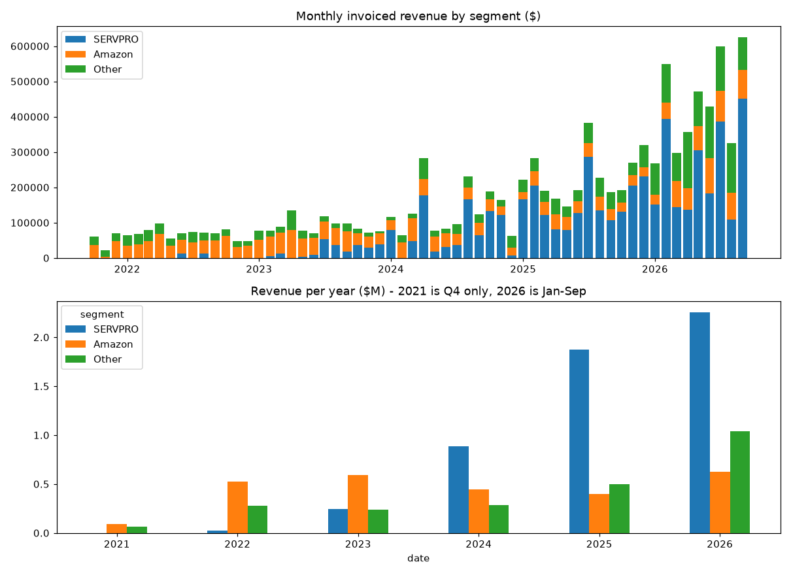
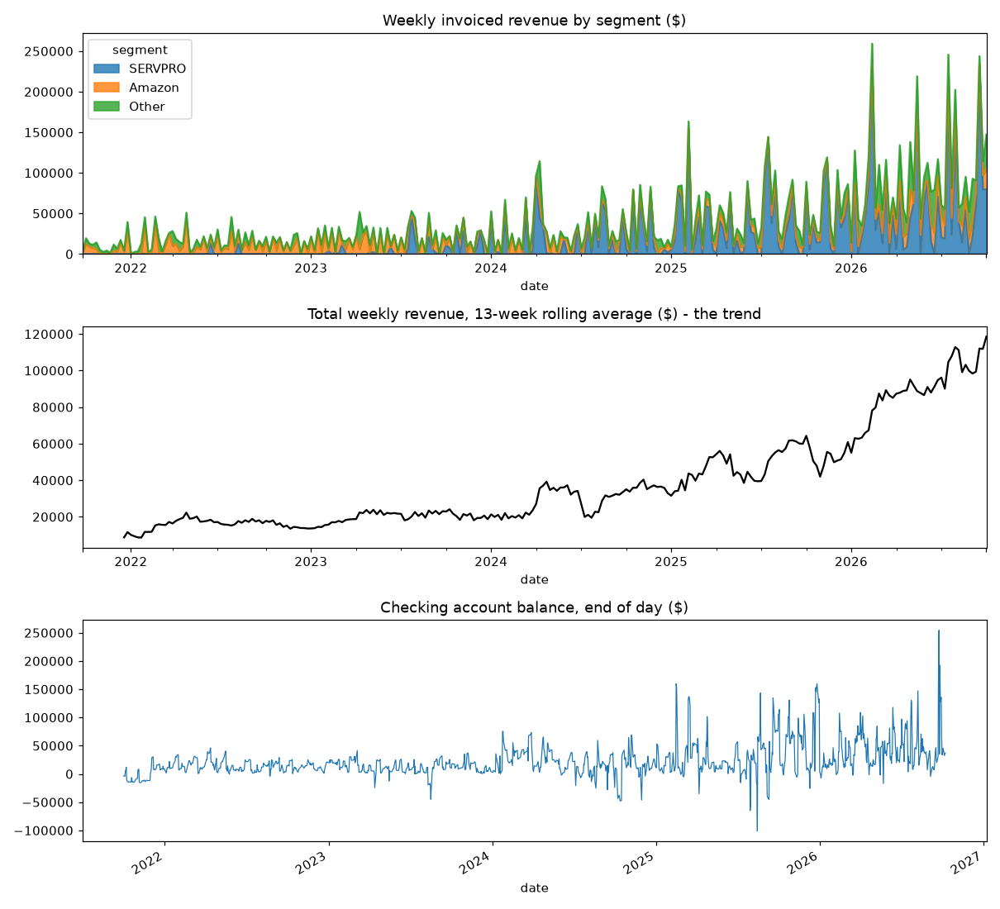
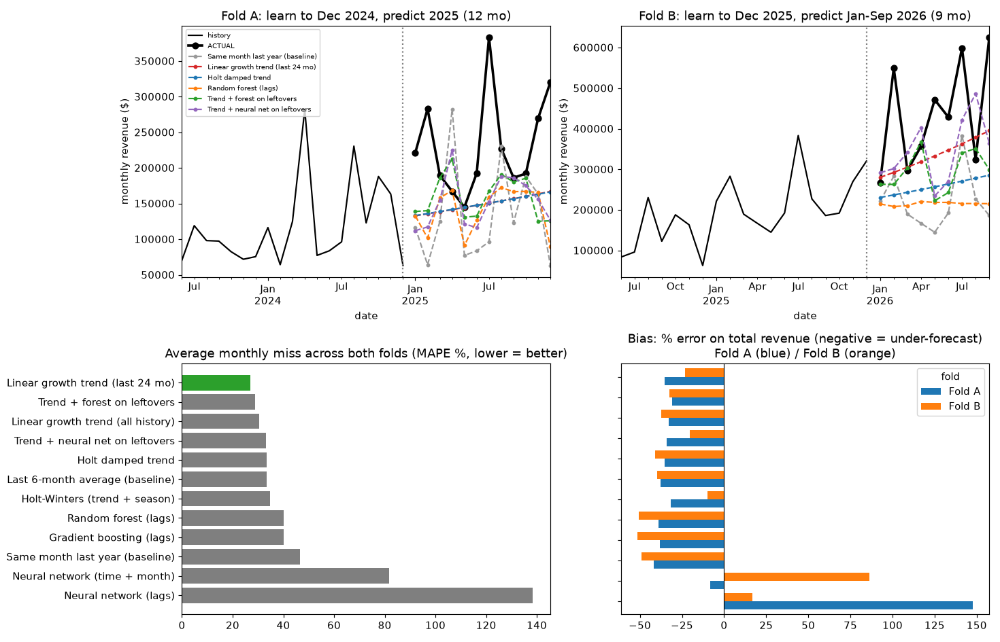
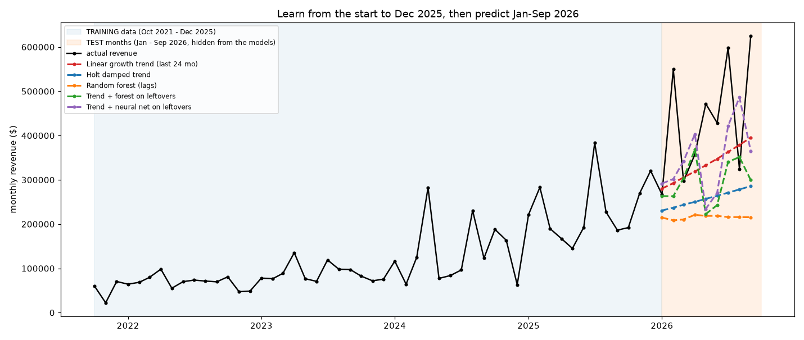
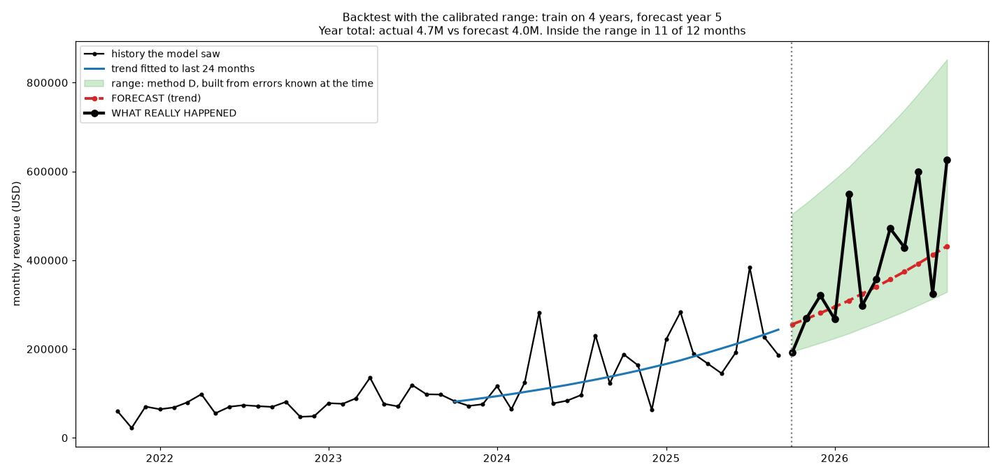
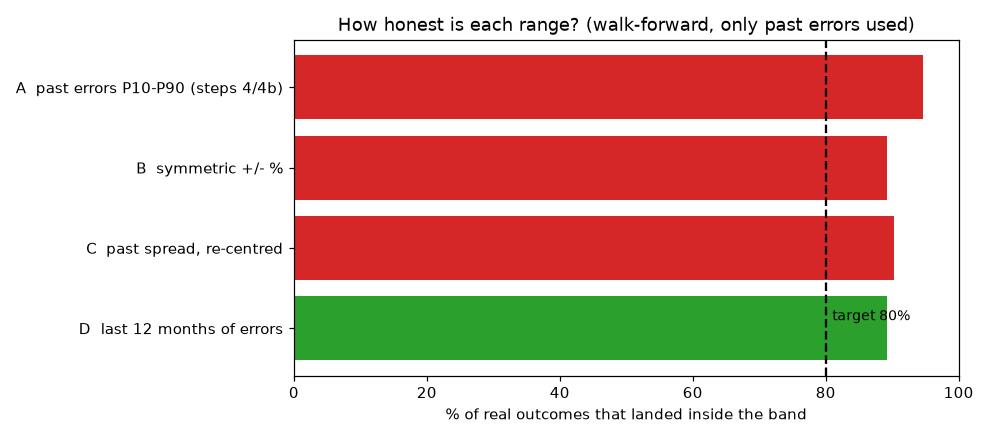
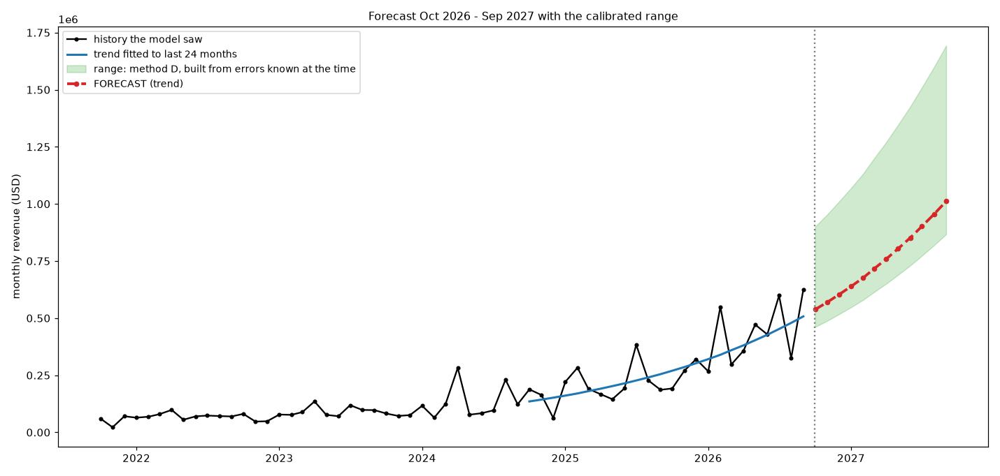

# Overview

**Question:** can 5 years of Zoho history forecast revenue beyond week 13?

**Answer:** yes for the growth trend and a range. No for single months.

| 60 months of data | 12 models compared | 27% average monthly miss | 14% miss on the year |
|---|---|---|---|

# Step 1. The data

- 3,529 invoices, 3,411 after removing void, draft and $0.
- 60 clean months, split into SERVPRO, Amazon and Other.
- SERVPRO is about 50% of revenue.

# Step 2. Compare 12 models

- Tested on months the models never saw, in two separate tests.
- Winner: a straight-line growth trend, 27% average monthly miss.
- Random forest and boosting go flat. Neural networks overshoot.

# Step 3. Learn to 2025, predict 2026

- Red line follows the growth. Orange (random forest) stays flat.
- Real months jump between $270k and $620k.
- Every model is too low: growth sped up.

# Step 4. Backtest: what a miss looks like

- Trained on 4 years, forecast year 5.
- Year total: actual $4.7M vs forecast $4.0M, a 14% miss.
- 11 of 12 months landed inside the range.

# Step 5. Make the range honest

- Tested 4 range methods, using only past-known errors.
- Chosen: last 12 months of errors. 89% of outcomes inside.
- The first version caught only 4 of 12 months. Testing found it.

# Step 6. The forecast: Oct 2026 to Sep 2027

- Trend: $9.0M for the year. Range: $7.7M to $15.1M.
- Caution: the trend compounds about 100% a year.
- A dollar-based line gives $7.1M, below the range.

# Takeaways and next steps

**Takeaways**

- A simple growth trend with a range is the right tool for 60 data points.
- Annual totals are usable. Single months miss by 20% to 30%.
- Every claim was tested on months the model had not seen.

**Next**

1. Test the compounding trend against the dollar-based line.
2. Forecast SERVPRO, Amazon and Other separately.
3. Turn monthly revenue into weekly receipts for weeks 14 to 52.
4. Database, plus a forecast vs bank balance scorecard.
