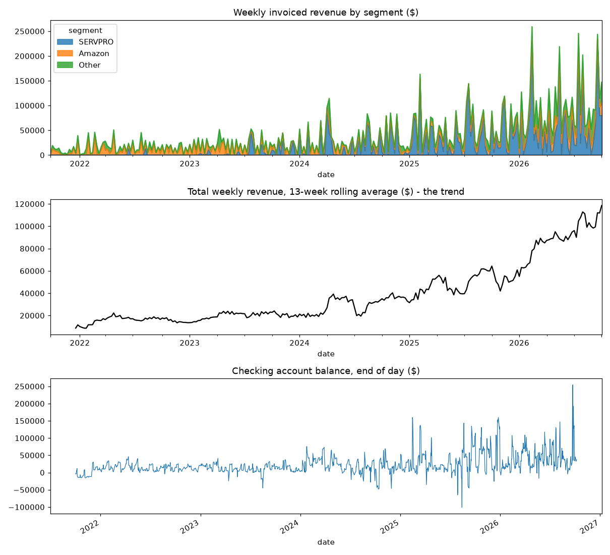
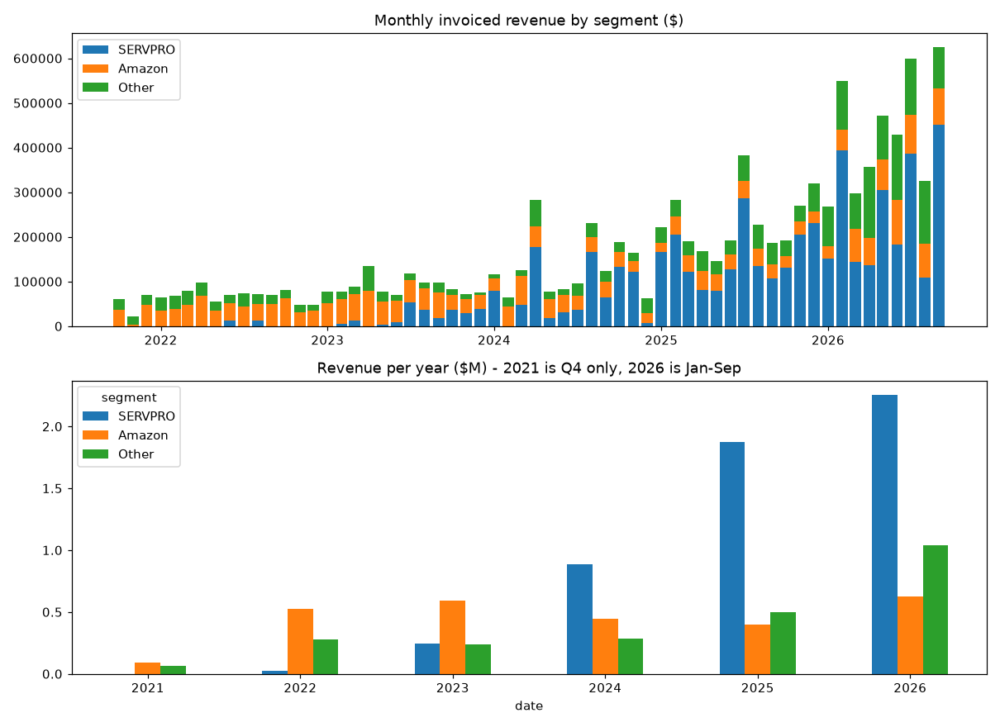
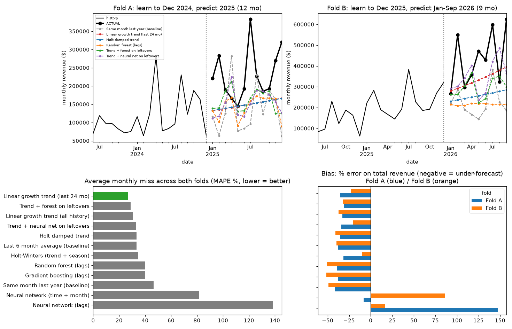
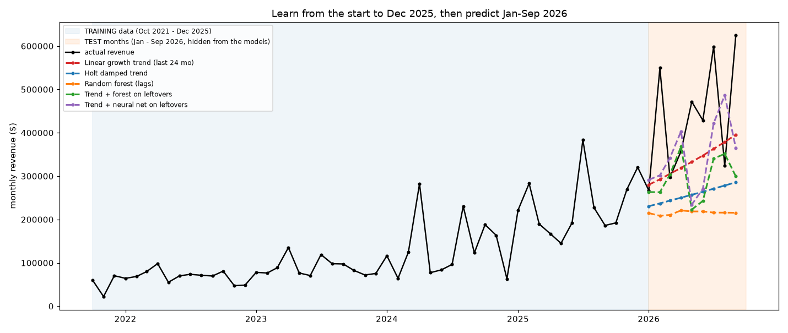
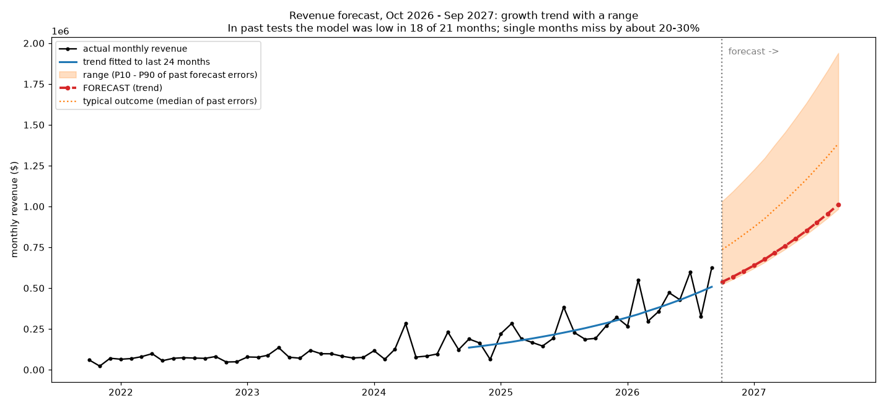
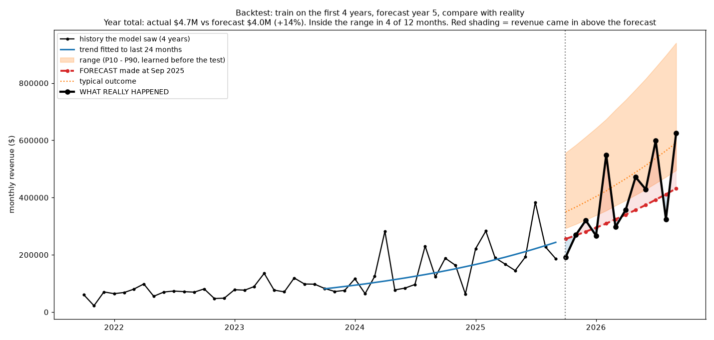

# Revenue trend forecasting from 5 years of Zoho history

Working report, steps 1 to 4b. Written 30 Oct 2026. Code is in this folder; run order is in section 9.

## 1. Why this work

The cash flow engine forecasts 52 weeks. The first 13 weeks are timed with ML (when open invoices and orders get paid). Weeks 14 to 52 rest on fixed assumptions, because the model only times invoices and orders that already exist. The ML approach document names "forecast future sales from five years of invoices" as the biggest next step.

This work asks: **can the 5-year Zoho history predict future revenue well enough to replace the flat assumptions, and how wrong will it be?**

## 2. Data

Source: `ml_data/Zoho_history_2021-10-01_to_2026-10-07.xlsx` (read-only; 10 datasets, 5 years). This work uses the invoices.

| Cleaning step | Invoices |
|---|---|
| Raw | 3,529 |
| Dropped: void | 19 |
| Dropped: draft | 12 |
| Dropped: $0 total (all paid, no revenue effect) | 87 |
| **Kept** | **3,411 ($10.37M)** |

- The current month (Oct 2026, 6 days) was dropped so it would not look like a collapse.
- Result: **60 clean months, Oct 2021 to Sep 2026**, no gaps, totals reconcile to the invoices.
- Revenue is split into SERVPRO, Amazon and Other.

| Year | Revenue |
|---|---|
| 2021 (Q4 only) | $0.15M |
| 2022 | $0.83M |
| 2023 | $1.07M |
| 2024 | $1.61M |
| 2025 | $2.78M |
| 2026 (Jan to Sep) | $3.92M |




What the data shows:
- Revenue grew about 10 times in five years, and the growth accelerated in 2025 and 2026.
- SERVPRO is about 50% of revenue; the top 5 customers are 75%.
- Single months are lumpy (from about $108k to $450k for SERVPRO alone).
- The checking-account balance does not trend. It is managed with transfers and deposits, so it is not a good direct target. Cash in and out would be modelled instead.
- Open question: 663 journal entries (about $1.7M, almost all money in, no payee) in the checking account. Their meaning needs the client's finance contact before any cash target is modelled.

## 3. Model comparison (step 3)

Time-based tests only, never random. Each model learns up to an origin month, forecasts the following months in one go, and is scored on what happened.

- **Fold A:** learn to Dec 2024, predict 2025 (12 months).
- **Fold B:** learn to Dec 2025, predict Jan to Sep 2026 (9 months).

MAPE is the average monthly miss in percent, lower is better.

| Model | Fold A | Fold B | Average |
|---|---|---|---|
| **Linear growth trend (last 24 months)** | 31 | 23 | **27** |
| Trend + forest on leftovers | 29 | 29 | 29 |
| Linear growth trend (all history) | 29 | 33 | 31 |
| Trend + neural net on leftovers | 34 | 32 | 33 |
| Holt damped trend | 31 | 36 | 34 |
| Last 6-month average (baseline) | 33 | 34 | 34 |
| Holt-Winters (trend + season) | 35 | 35 | 35 |
| Random forest (lags) | 34 | 46 | 40 |
| Gradient boosting (lags) | 33 | 47 | 40 |
| Same month last year (baseline) | 47 | 46 | 47 |
| Neural network (time + month) | 53 | 111 | 82 |
| Neural network (lags) | 241 | 36 | 138 |




Findings:
- **The simplest model wins.** A straight-line growth trend fitted to the last 24 months, at about a 27% monthly miss.
- **Trees cannot extrapolate growth.** Random forest and gradient boosting go flat at the highest level they saw in training.
- **Raw neural networks are unstable.** About 50 data points is far too few; they overshoot wildly. A neural net that only learns the leftovers around the trend stays sane but is not better than the line.
- **Every trend, tree and baseline model under-forecasts** (by 10% to 50% on total revenue), because growth accelerated beyond what the history implied. Only the unstable raw neural nets over-forecast.
- Ten further trend variants (quadratic, dollar-based line, robust line, ARIMA, undamped Holt, regression with month dummies, an average of models) all landed between 25% and 34%. The differences are within the noise of 21 test months, so **model choice barely matters; information does.**

Two ideas were tested and did not hold up:
- Sales orders are not a leading indicator. The median gap from order date to ship date is 1 day, so orders turn into invoices almost immediately.
- SERVPRO is not driven by a few huge invoices: 148 invoices since Oct 2025, median $7.6k, the top 5 are 20% of its revenue.

## 4. Forecast for the next 12 months (step 4)

Linear trend (last 24 months, Oct 2024 to Sep 2026) trained on all 60 months. Growth fitted: 5.9% per month.

| | Oct 2026 to Sep 2027 |
|---|---|
| Last 12 months, actual | $4.7M |
| Trend forecast | $9.0M (+92%) |
| "Typical" (median of past errors) | $12.4M |
| High (P90) | $17.3M |



**Caution.** The log-linear trend compounds at about 100% a year, reaching about $1M a month by Sep 2027, and the band inherits the 2025 to 2026 acceleration (actual beat the trend in 18 of 21 backtest months). A dollar-based line gives $7.1M (+51%) and is a more reasonable planning figure. The range method is being fixed in step 5.

## 5. Backtest: what a miss looks like (step 4b)

Same model, run in the past: train on the first 4 years (Oct 2021 to Sep 2025), forecast year 5 (Oct 2025 to Sep 2026), compare with reality.

| | Result |
|---|---|
| Year total | actual $4.70M vs forecast $4.04M, **14% miss** |
| Average monthly miss | 20% |
| Actual above the trend line | 8 of 12 months |
| Actual inside the P10 to P90 range | **4 of 12 months** (should be about 10) |



The annual number is usable. Single months are not (Feb 2026 was +44%, Aug 2026 was -27%). The range failed because it was learned from 2025, when revenue beat the trend by about 37% at the median; in the test year the gap was about 17%.

## 6. Conclusions so far

1. The history supports a **growth-trend forecast with a range**. It does not support predicting single months better than about 20% to 30% off.
2. 60 monthly points are too few for random forests, gradient boosting or neural networks. Simple, explainable trends win.
3. The error is mostly a **level miss** (the business accelerated), not random noise, so ranges must be calibrated, not copied from one period.
4. The existing payment-timing ML works because it learns from thousands of invoices. The same kind of record-level data is where more ML belongs.

## 7. Open items

- Meaning of the 663 checking-account journal entries (client finance contact).
- Confirm the SERVPRO payment pattern (about 11 days after invoice) with the client, from the earlier ML document.
- Range method (step 5).

## 8. Next steps

| Step | What |
|---|---|
| 5 | Fix the range: find a band method that covers about 80% of months across all tests; redraw steps 4 and 4b |
| 6 | Forecast SERVPRO, Amazon and Other separately and test whether the sum beats one total |
| 7 | Turn monthly revenue into weekly receipts for weeks 14 to 52 of the cash forecast, using the payment-timing model |
| 8 | Warehouse database and a forecast-vs-bank-balance scorecard |

Later ambition (not started): a product in the spirit of clockwork.ai.

## 9. Reproduce

From the project root, with the Mac venv (`.venv-mac`):

```
.venv-mac/bin/python ml_work/01_explore_data.py
.venv-mac/bin/python ml_work/02_build_monthly_table.py
.venv-mac/bin/python ml_work/03_train_and_test.py
.venv-mac/bin/python ml_work/04_forecast_next_12_months.py
.venv-mac/bin/python ml_work/04b_backtest_last_year.py
```

Each script reads the history file or the previous step's output and writes charts and CSVs to `ml_work/outputs/` (git-ignored, regenerable). The charts in this report are copies in `ml_work/report/images/`.

Notes: the history file and this report contain real company figures. The repository is local only; check with the client before sharing it.
